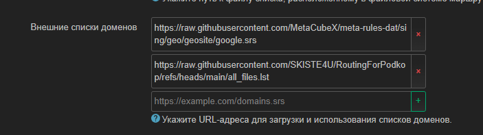

# Что делает этот репозиторий
При добавлении или изменении любого файла в [sources](sources/), читает их и добавляет каждый уникальный домен в `all_files.lst`.  

# Для чего это нужно
Что бы не вписывать каждый домен отдельно в настройках podkop, и не захламлять сами настройки podkop'а кучей ссылок.

# Как использовать?
Вставить `https://raw.githubusercontent.com/SKISTE4U/RoutingForPodkop/refs/heads/main/all_files.lst` в настройки Podkop, а именно в "Внешние списки доменов"  
  

---
Вы так же можете делать форк этого проекта, и добавлять\удалять нужные вам сервисы

# Доп информация
Код был "навайбкожен" через Gemini, списки доменов беру в основном с [routeruls.site](https://routeruls.site/geosite/), но так же можно самостоятельно достать все нужные домены с сайта или приложения по [этому гайду](https://itdog.info/analiziruem-trafik-i-opredelyaem-domeny-kotorye-ispolzuyut-sajty-i-prilozheniya/)
